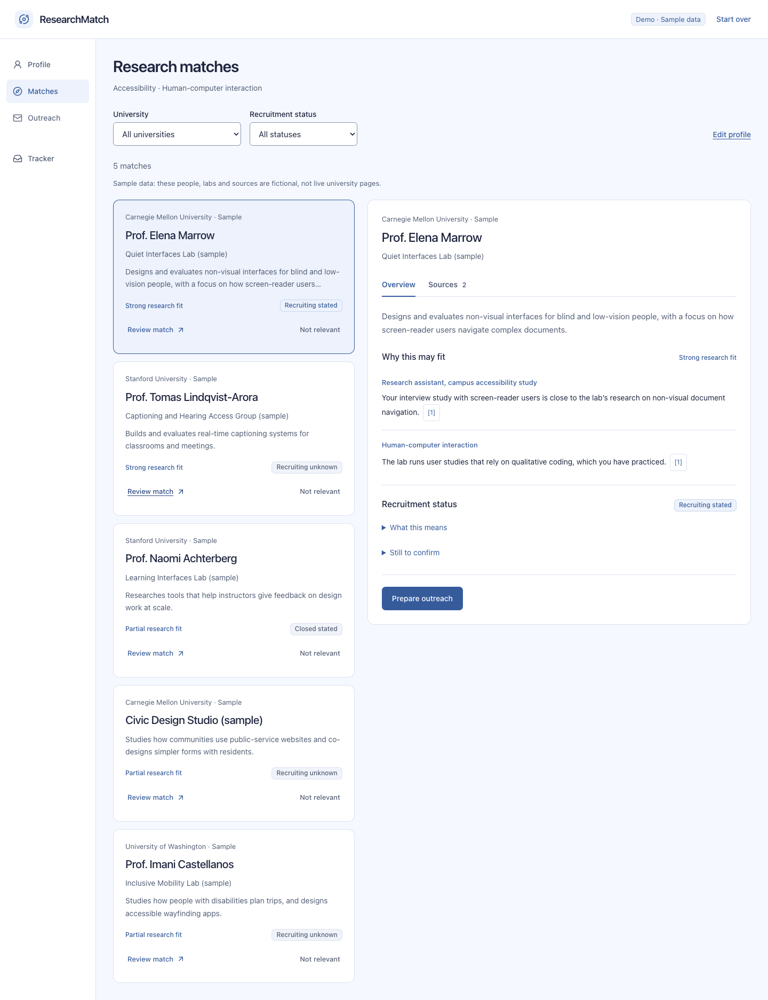
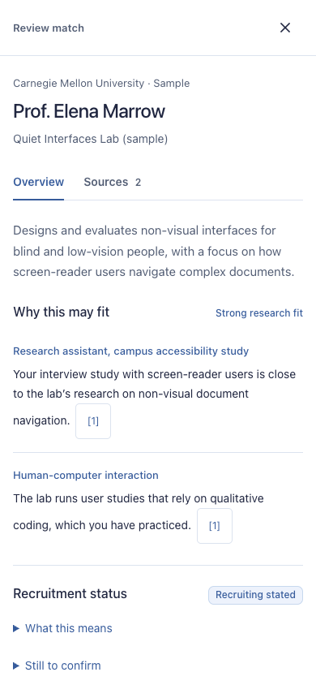

# Light blue workspace

This refresh builds on ResearchMatch-X at `2ab7f6e46efe9720e07d62802b2ac985d228c8f3`. It implements the approved blue workspace direction while retaining the existing backend, adapters, matching semantics and persistence format.

## Design decisions

- Fix the app to a light color scheme: pale blue canvas, white surfaces and dark text, even with a dark OS preference. Native form controls also use the light scheme.
- Use a consistent sans-serif type hierarchy, with whitespace and common text edges instead of repeated paragraphs and large status blocks.
- Keep compact candidate cards beside a non-modal evidence inspector at widths of 1100px and above. On smaller screens, reuse the same review content in the existing full-screen dialog, with Escape and focus restoration.
- Keep research fit separate from recruitment status. Put extended explanations and unknowns behind disclosure controls without hiding the recruitment label itself.
- Make each citation switch to Sources, highlight its corresponding entry and move keyboard focus there. Reading an AI summary does not mark a source as opened; only opening its actual external link does.
- Use one explicit review step before the selected candidate enters the existing outreach flow. Changing candidates remounts the review content and resets confirmation.
- Collapse experience editing and optional preferences. Retain the existing form fields, validation, draft overwrite protection, error recovery, exports and tracker operations.

## References and attribution

The team supplied StudyConnect coursework as a visual reference. The relevant principles were content-first hierarchy, generous spacing, consistent controls, common regions, alignment and progressive disclosure. The cool neutral text/surface palette informed this implementation; its accent was adapted to blue. No StudyConnect graphics or components were imported.

External interaction references:

- [Carbon button guidelines](https://www.carbondesignsystem.com/building-blocks/core/components/button/guidelines): action labels, restrained emphasis and action grouping.
- [NN/g progressive disclosure](https://www.nngroup.com/articles/progressive-disclosure/): show supporting detail when requested.
- [Linear Peek](https://linear.app/docs/peek): retain list context during inspection.

No third-party application code was copied and no dependencies were added. Implementation used Codex assistance; user briefs are recorded in [frontend-prompts.md](frontend-prompts.md). Existing application prompts remain in the backend service source files and were not changed by this refresh.

## Scope and verification

Existing state and persistence behavior continues to be covered by Vitest. Playwright covers the full Demo flow, local-stub Live wiring, failure handling, citations, explicit review, edited drafts, tracker operations, mobile review and the forced light scheme under a dark OS preference. Local-stub tests do not establish real-model accuracy or current recruiting availability.

Deferred work includes nationwide coverage, learned ranking, per-candidate working drafts, literal quotation extraction and source-page highlighting. These require separate product/data work.

## Screenshots

Actual Demo screens captured by the Playwright appearance check, with a dark OS preference. All people and labs shown are fictional sample data.

### Desktop matches

### Mobile evidence review

